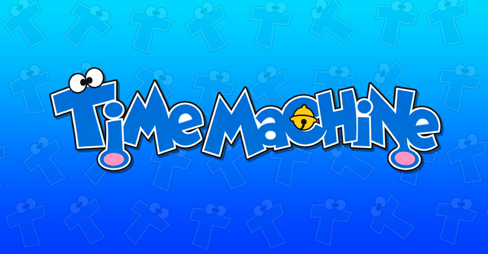

 <div align="center">
 
 <br> <br>

**By the community, For the community.**

A community-driven archive dedicated to preserving the world of Doraemon, one episode, movie and detail at a time.

[](https://timemachine.website)
[](https://react.dev)
[](https://developer.mozilla.org/en-US/docs/Web/JavaScript)
[](https://supabase.com)

</div>

---

## About

**Time Machine** is a community-driven archive dedicated to documenting and preserving the world of [Doraemon](https://en.wikipedia.org/wiki/Doraemon).

With decades of episodes, movies, characters, gadgets and stories, Doraemon has an enormous history worth preserving. Time Machine aims to bring all of that information together in one organised, accessible place.

Our goal is to document as much of Doraemon as possible, including detailed information about individual episodes, movies, characters and more.

This is not something one person can accomplish alone.

**Time Machine is built entirely around community contributions.** Whether you know an episode's original broadcast date, have information about a character, can correct an existing entry or simply want to help document something missing, every contribution helps.

## What we're archiving

Time Machine currently focuses on three main catalogues:

| Catalogue | Description |
| --- | --- |
| **Doraemon (1979)** | Episodes and information from the 1979 anime adaptation. |
| **Doraemon (2005)** | Episodes and information from the 2005 anime adaptation. |
| **Doraemon Movies** | Doraemon's theatrical movie releases and their details. |

Alongside these catalogues, the archive also documents characters, gadgets and other information connected to the series.

Our aim is to make the archive as complete and accurate as possible, rather than simply collecting episode titles.

## Community contributions

Time Machine depends on its community.

Anyone can create an account and contribute knowledge to the archive. You do not need to be a developer or have a GitHub account to help.

Contributions can include:

- Adding missing episodes or movies.
- Correcting existing episode and movie information.
- Providing Japanese and English titles.
- Adding synopses and other metadata.
- Documenting characters and gadgets.
- Providing images and episode screenshots.
- Suggesting corrections or reporting inaccurate information.
- Sharing other useful information about Doraemon.

### How it works

1. **Create an account** using Discord authentication.
2. **Submit a contribution** through the website.
3. **Wait for review.** Our team of checkers and administrators reviews submissions.
4. **Get a decision.** Contributions can be accepted or declined.
5. **Help grow the archive.** Accepted contributions become part of Time Machine.

Contributors can track their submissions and see their contribution history through their account.

### Review and moderation

To maintain the quality and accuracy of the archive, contributions are reviewed by authorised members of the team.

Checkers and administrators can review submissions, make necessary corrections, accept valid information and decline inaccurate or unsuitable contributions.

Changes to the archive are recorded so that contributions and modifications remain accountable.

## How it works

Time Machine uses a relatively simple architecture designed to keep the archive organised and maintainable.

- **Frontend:** The website is built using React, JavaScript, HTML and CSS.
- **Archive data:** Information about episodes, movies, characters and gadgets is stored in JSON files.
- **Backend:** Supabase handles authentication, accounts, contribution management and other backend functionality.
- **Authentication:** Users can connect their Discord accounts to sign in.
- **Archive updates:** Approved contributions are processed through the backend and reflected in the archive data.

Keeping the archive data in JSON makes it structured, portable and easier to maintain independently of the website itself.

## Technology stack

| Technology | Purpose |
| --- | --- |
| JavaScript | Application logic and functionality |
| React | Frontend interface |
| HTML | Website structure |
| CSS | Styling and responsive design |
| Vite | Frontend development and build tooling |
| Supabase | Authentication, database and backend services |
| JSON | Archive data storage |
| GitHub | Source code and archive repository |

## Getting started

Want to explore the code or work on Time Machine locally?

### Requirements

- [Node.js](https://nodejs.org/)
- npm
- Git

### Installation

Clone the repository:

```bash
git clone https://github.com/karrizzmaa/time-machine.git
cd time-machine
```

Install dependencies:

```bash
npm install
```

Start the development server:

```bash
npm run dev
```

Vite will provide a local development URL in your terminal.

### Building for production

To generate a production build:

```bash
npm run build
```

The generated website will be available in the `dist` directory.

To preview the production build locally:

```bash
npm run preview
```

**Backend configuration:** If you are working on authentication or other backend functionality, configure the required Supabase environment variables using the project's `.env.example` file. Never commit real credentials or private secrets.

## Contributing to the project

There are two ways to help Time Machine grow:

**Archive contributions**

If you have information about Doraemon, use the contribution forms on the website. You can submit information without modifying the source code or opening a GitHub pull request.

**Development contributions**

If you want to improve the website itself, work on the source code and submit your proposed code changes through the repository's contribution process.

Please keep changes organised, preserve existing archive data structures and avoid introducing unnecessary dependencies.

## Our goal

Doraemon has been around for generations, and its history is far too extensive for a single person to document.

Episodes, movies and information can become difficult to find over time. Time Machine exists to bring that information together and make it easier for everyone to explore, discover and contribute to.

Every correction, every missing detail and every documented episode brings us a little closer to a complete archive.

**By the community, For the community.**

---

## Disclaimer

Time Machine is an independent, non-commercial fan-made archival project. It is not affiliated with, endorsed by or officially associated with Fujiko F. Fujio, Shogakukan, TV Asahi, Shin-Ei Animation, or any other Doraemon rights holders.

Doraemon and all related characters, names, trademarks and copyrighted materials belong to their respective owners.

Time Machine does not claim ownership of third-party media or materials referenced by the archive. External links and resources are provided for informational and archival reference purposes. Their availability and content are controlled by their respective providers.

---

<div align="center">

**Made by the community, for everyone who loves Doraemon.**

[Visit Time Machine](https://timemachine.website)

</div>
